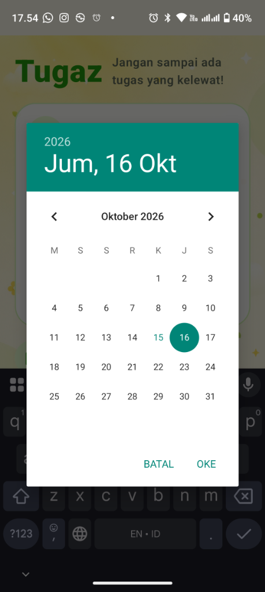
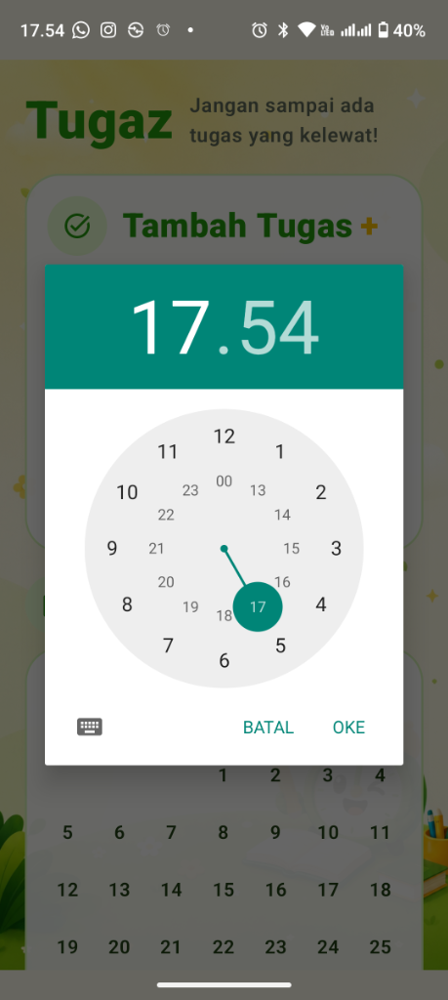
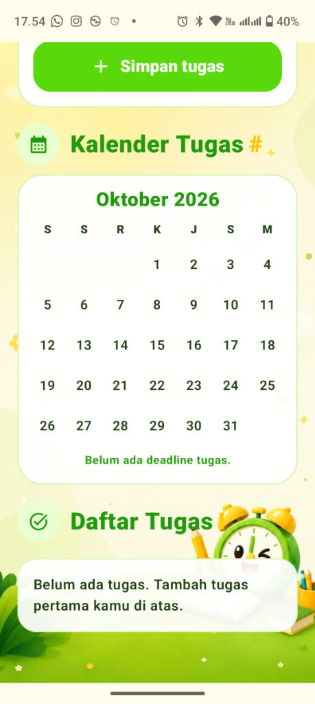

# Tugaz

Aplikasi Android Kotlin untuk mencatat tugas, melihat deadline di kalender, dan menerima pengingat 24 jam sebelum deadline.

## Fitur

- Tambah dan hapus tugas.
- Pilih tanggal serta jam deadline.
- Kalender yang menandai tanggal deadline tugas.
- Notifikasi pengingat H-1.
- Data tugas tersimpan lokal pada perangkat.

## Tampilan Aplikasi

### 1. Tambah Tugas


### 2. Pilih Tanggal Deadline


### 3. Pilih Jam Deadline


### 4. Kalender & Daftar Tugas (Kosong)


### 5. Kalender & Daftar Tugas (Tersimpan)


Gambar di atas mendokumentasikan antarmuka Tugaz saat dijalankan langsung pada perangkat Android: form input tugas, pemilihan tanggal dan jam deadline, kalender penanda tugas, serta daftar tugas yang tersimpan.

## Refleksi Singkat

Tugaz dibuat untuk membuat pencatatan tugas terasa ringan dan mudah dipindai. Fokus utamanya adalah alur satu layar: pengguna menambahkan tugas, memilih deadline, lalu langsung melihat tanggal deadline pada kalender dan daftar tugas. Pengingat H-1 membantu pengguna mendapatkan konteks sebelum deadline tiba. Aplikasi telah berhasil diuji dan dijalankan secara langsung pada perangkat Android untuk memverifikasi tampilan pada ukuran layar nyata serta keandalan interaksi pengguna.

## Menjalankan project

Buka folder project dengan Android Studio, tunggu Gradle sync, lalu jalankan ke emulator atau perangkat Android. Atau build APK langsung melalui terminal:

```bash
# Build Debug APK
./gradlew assembleDebug

# Build Release APK
./gradlew assembleRelease
```
