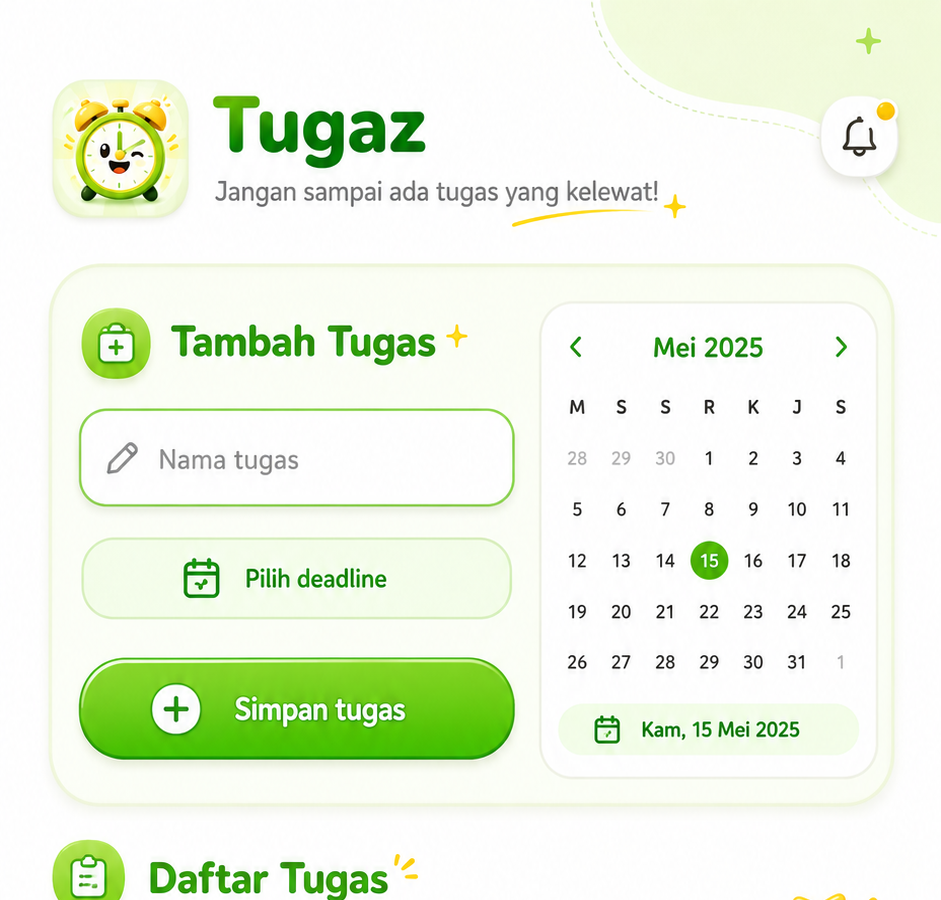
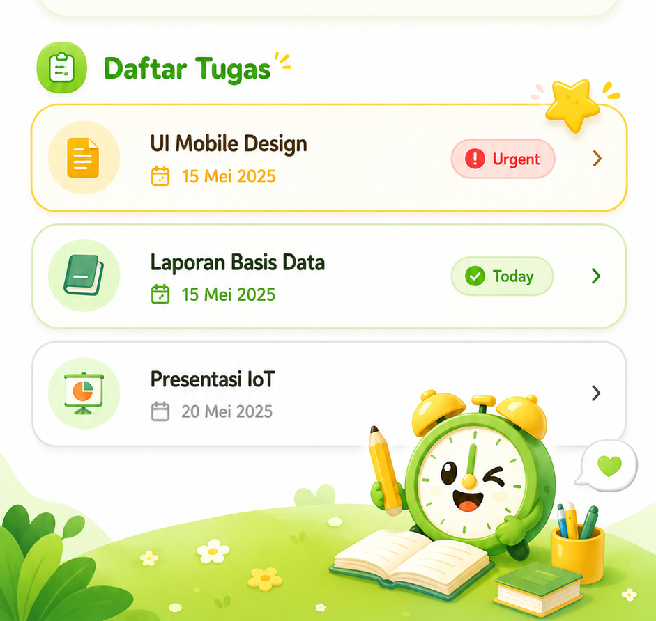

# Tugaz

Aplikasi Android Kotlin untuk mencatat tugas, melihat deadline di kalender, dan menerima pengingat 24 jam sebelum deadline.

## Fitur

- Tambah dan hapus tugas.
- Pilih tanggal serta jam deadline.
- Kalender yang menandai tanggal deadline tugas.
- Notifikasi pengingat H-1.
- Data tugas tersimpan lokal pada perangkat.

## Tampilan Aplikasi

### Tambah Tugas

### Daftar Tugas

Gambar di atas mendokumentasikan rancangan antarmuka Tugaz: input tugas, pemilihan deadline, kalender tugas, dan daftar deadline.

## Refleksi Singkat

Tugaz dibuat untuk membuat pencatatan tugas terasa ringan dan mudah dipindai. Fokus utamanya adalah alur satu layar: pengguna menambahkan tugas, memilih deadline, lalu langsung melihat tanggal deadline pada kalender dan daftar tugas. Pengingat H-1 membantu pengguna mendapatkan konteks sebelum deadline tiba. Tahap berikutnya yang paling berguna adalah menjalankan app di emulator atau perangkat Android untuk memverifikasi tampilan pada ukuran layar nyata serta perilaku notifikasi pada tiap versi Android.

## Menjalankan project

Buka folder project dengan Android Studio, tunggu Gradle sync, lalu jalankan ke emulator atau perangkat Android.
